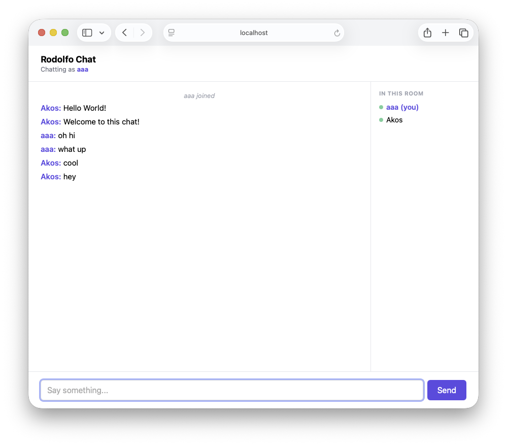

# Chat

A broadcast WebSocket chat room: a shared room password, a display name per
connection, and every message sent to everyone currently joined. It is the
smallest example that touches `ws`, `serving`, and `Plug`'s newer
`Plug.around` style together.



## Running it

```sh
tey install
tey run        # http://localhost:3000/
```

Open that URL in two or more browser tabs (or two different browsers), enter
`let-me-in` as the room password and a different name in each, and chat
between them.

## It is part of the Rodolfo monorepo

This example is a member of the checkout's Tey workspace (see the root
`package.kex`), so its own `package.kex` resolves Rodolfo from this checkout
rather than from a published release:

```rb
tey("rodolfo", workspace: true)
```

That line only works inside the workspace. Copied out of the monorepo, the
example stops installing until `package.kex` points at a release instead, the
way any other package would:

```rb
tey("rodolfo", git: "https://github.com/kexhq/rodolfo", tag: "~> 0.2")
```

or `tey add rodolfo --git https://github.com/kexhq/rodolfo --tag "~> 0.2"`,
then `tey install` again.

## Layout

| File | Owns |
| --- | --- |
| `src/main.kex` | spawning the room and starting the server |
| `src/chat/site.kex` | the room password and the routes (module `Chat.Site`) |
| `src/chat/room.kex` | the `serving Room` connection registry (module `Chat.Room`) |
| `src/chat/views.kex` | the login form and the chat page (module `Chat.Views`), rendered from `login.html.ket` and `chat.html.ket` |
| `src/chat/protocol.kex` | the three line shapes the room and the browser agree on (module `Chat.Protocol`) |
| `spec/` | those two, checked without a server: `tey test` |
| `spec/browser/` | the whole room in Chrome: `tey test:browser` |

Both `Chat.Views` and `examples/library`'s own `Library.Views` are
namespaced to the example they belong to on purpose: `tey` resolves the
workspace `rodolfo` dependency by pulling in every sibling example under
`examples/*`, so a bare `module Views` in more than one of them collides —
see `docs/kex-issues.md` #26.

## Specs

```sh
tey test
```

Everything a spec can reach here is a pure function of what a request
carried, so that is what they cover: the wire format in `Chat.Protocol`, and
what the two pages escape. The chat page is the interesting half — a display
name is nothing but a query parameter, so it has to survive being rendered as
HTML *and* being handed to the page's own `<script>` as a JavaScript string
literal, which is two different escapes on the same stranger's text.

The routes and the `serving Room` registry need a running server and a
browser on the other end of the socket: the browser specs below cover them.

## In a browser

`spec/browser/chat.spec.kex` drives the example in Chrome through
[Shakespeare](https://github.com/kexhq/shakespeare): the login form, a wrong
password, a name already taken, and two people, each in a page of their own,
chatting over the WebSocket. Each case serves the routes in
`src/chat/site.kex` on a port of its own.

```sh
tey test:browser   # headless, in the background
tey test:watch     # a visible Chrome, each action highlighted and paced
```

`tey test` leaves them out: it runs `spec/*.spec.kex` alone.

## Idle connections

A client that says nothing still stays in the room. That is worth naming
because it did not used to: `receiveMessage` answers its own 31-second call
timeout, and reading that as a disconnect hung up on anyone who hadn't typed
in half a minute. `src/main.kex` tells a `Timeout` apart from a real close
and keeps waiting — see `docs/kex-issues.md` #28 in the main checkout.

## How the password and name travel

There's no session or cookie here — the room password and display name are
query parameters on the WebSocket URL itself (`/chat?token=...&name=...`),
checked by the `ws` handler after the handshake completes (Rodolfo's `ws`
always accepts the upgrade; closing the connection right away is how it
rejects one after the fact). Good enough to show `ws` reading the request it
was upgraded from — not how real auth should work.
